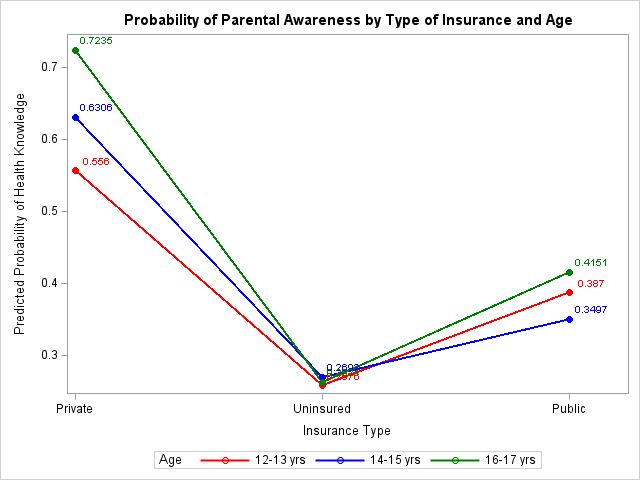

# Parental Awareness and Adolescents' Future Health Insurance

**Exploring the Impact of Current Insurance Type and Socioeconomic Factors**

MPH Capstone (Epidemiology & Biostatistics) · CUNY Graduate School of Public Health & Health Policy · December 2024
Author: Akib Rahman · Advisor: Dr. Chloe Anya Mirzayi

📄 **[Read the full paper (PDF)](paper/Rahman_Akib_CapstonePaper.pdf)** · [Word version](paper/Rahman_Akib_CapstonePaper.docx)

*Revised in 2026 to correct reporting in Tables 2–3 and the related text. The originally submitted version is in this repository's commit history.*

---

## Research question

As adolescents approach adulthood, their health insurance eligibility often changes. Medicaid and CHIP coverage typically ends between ages 19 and 21, depending on the program and state, and dependent coverage under a parent's private plan generally ends at 26. These transitions can create coverage gaps, particularly for families unfamiliar with their options. This project asks:

**Does an adolescent's current insurance type (private, public, or uninsured) affect whether their parents know how the child will be insured as an adult?**

## Data and study population

- **Source:** [2022 National Survey of Children's Health (NSCH)](https://www.census.gov/programs-surveys/nsch.html), U.S. Census Bureau / HRSA Maternal and Child Health Bureau
- **Sample:** 18,423 adolescents aged 12–17, with complete data on every analysis variable. Of the 18,762 asked the outcome question, 339 were excluded for missing insurance type; no covariates had missing values.
- **Outcome:** Parent's answer to *"Do you know how this child will be insured as they become an adult?"* (yes/no)
- **Exposure:** Insurance type (any public, private only, uninsured)
- **Covariates:** Age group, race/ethnicity, household Federal Poverty Level (FPL), special health care needs (SHCN)

## Key findings

*Percentages are weighted population estimates from the 2022 NSCH. Odds ratios come from survey-weighted logistic regression.*

**Descriptive (weighted, unadjusted)**
- Overall, an estimated **52.4%** of parents reported knowing how their adolescent would be insured as an adult.
- Awareness was highest among parents of privately insured adolescents (**63.6%**) and lowest among parents of uninsured adolescents (**26.3%**).
- Awareness rose with household income: 65.7% at ≥400% FPL vs. 39.4% at 0–99% FPL.

**Adjusted associations** (controlling for age, SHCN, race/ethnicity, and FPL)
- Compared with parents of privately insured adolescents, parents of uninsured adolescents had **77% lower odds** of awareness (aOR 0.23, 95% CI 0.16–0.34) and parents of publicly insured adolescents had **57% lower odds** (aOR 0.43, 95% CI 0.36–0.51).

**Effect modification by age**
- The public–private gap widened with age (insurance × age interaction, joint p = 0.004). Weighted awareness among parents of privately insured adolescents rose from 56% at ages 12–13 to 72% at ages 16–17, but stayed between 35% and 42% for publicly insured adolescents. These are the years just before Medicaid/CHIP eligibility typically ends.
- Interactions with SHCN, race/ethnicity, and FPL were not statistically significant.

## Figures

Each plot shows the predicted probability of parental awareness by insurance type from that covariate's interaction model. Because each model includes every insurance × subgroup combination, these equal the weighted awareness percentages for each group.

| Federal Poverty Level | Age |
|---|---|
|  |  |
| **Race/ethnicity** | **Special health care needs** |
|  |  |

## Methods

All analyses were run in **SAS 9.4** and account for the NSCH's complex survey design (weights, strata, clusters).

- **Descriptive statistics:** weighted population percentages, compared with Rao-Scott chi-square tests
- **Regression:** crude and adjusted survey logistic regression, reported as odds ratios with 95% CIs (reference-cell coding)
- **Effect modification:** separate insurance type × covariate interaction models, each assessed with a joint Wald test
- **Visualization:** predicted-probability interaction plots

## Limitations

- **Cross-sectional design:** the study identifies associations but can't establish whether current insurance type influences parental awareness or the other way around.
- **Self-reported awareness:** the outcome captures whether parents *report* knowing how their child will be insured, not whether they have a concrete or accurate coverage plan.
- **Unmeasured confounding:** parental education, health literacy, and access to transition-planning resources may influence both insurance type and awareness.
- **Insurance categorization:** grouping "public only" with "public + private" into an any-public category may hide differences between coverage arrangements.
- **Generalizability:** findings reflect 2022 and may not capture later changes in insurance policy or eligibility (e.g., the end of Medicaid continuous enrollment in 2023).

## Reproducing the analysis

**Requirements**
- SAS 9.4, or the free [SAS OnDemand for Academics](https://www.sas.com/en_us/software/on-demand-for-academics.html)
- 2022 NSCH Topical file in SAS format (`nsch_2022e_topical.sas7bdat`), from the [Census Bureau NSCH datasets page](https://www.census.gov/programs-surveys/nsch/data/datasets.html). It's not stored here because the file is over 200 MB and freely available from the source.

**Steps**
1. Open [`code/capstone_analysis.sas`](code/capstone_analysis.sas).
2. Change the `libname` path near the top of the script (line 19) to the folder holding the data file.
3. Run the program.

The program goes through each step in the paper:

| Step | Procedure | Output |
|---|---|---|
| Sample flow and raw-value checks (incl. NSCH special missing codes) | `PROC SQL`, `PROC FREQ`, `PROC MEANS` | 54,103 children in the file → 18,762 aged 12–17 asked the outcome question → 18,423 with a reported insurance type |
| Recode exposure, outcome and covariates, then verify each recode | `DATA` step, `PROC FREQ` | Analytic sample, n = 18,423 |
| Weighted descriptives, Rao-Scott χ² | `PROC SURVEYFREQ` | Table 1 |
| Crude and adjusted logistic regression | `PROC SURVEYLOGISTIC` | Table 2 |
| Insurance × covariate interaction models | `PROC SURVEYLOGISTIC` | Table 3 |
| Predicted-probability interaction plots | `PROC MEANS` + `PROC SGPLOT` | Figures 1–4 |

All procedures use the NSCH design variables (`STRATA FIPSST STRATUM`, `CLUSTER HHID`, `WEIGHT FWC`).

> **About the code:** I lost the original program when my university virtual-desktop account closed, so I rebuilt this script from the paper's Methods section in 2026. I ran the rebuilt program in SAS OnDemand for Academics on the 2022 NSCH public-use file and compared its output with the tables and figures in the paper. The sample sizes, weighted percentages, odds ratios, confidence intervals, and p-values all match.

## Repository contents

```
paper/      Capstone paper (PDF and Word)
code/       SAS program: data checks, recodes, Tables 1–3, Figures 1–4
figures/    Interaction plots from the paper
```

## Looking back

If I were starting this project today, I would approach a few things differently:

- **Report effects on a probability scale.** Because awareness was common (about 52%), odds ratios can exaggerate relative differences compared with prevalence ratios. An adjusted OR of 0.23 means 77% lower *odds*, not 77% lower *probability*. I'd lead with adjusted predicted probabilities or prevalence ratios, which are easier for policymakers to interpret. Even the unadjusted weighted estimates make the gap clear: about 26% of parents of uninsured adolescents were aware, compared with 64% of parents of privately insured adolescents.
- **Use subpopulation (DOMAIN) analysis.** Instead of subsetting the file to adolescents with complete data, I'd keep the full sample in the survey procedures and define the analytic group as a domain. That's the recommended way to keep variance estimates design-correct.
- **Keep "public only" and "public + private" separate,** so differences between those coverage arrangements are visible instead of averaged together.
- **Account for state policy.** Medicaid and CHIP age limits and transition rules differ by state. Adding state-level variables (e.g., Medicaid expansion status), or using models that account for state, would connect the results more directly to policy.
- **Add measures of parent knowledge and resources.** Parent education, health literacy, and whether the adolescent has a medical home with transition planning (all in the NSCH) could help explain *why* awareness differs.
- **Write a pre-specified analysis plan and use version control from day one.** Writing out each model before running it, and keeping the code in a Git repository, makes every number easy to trace. It also would have saved my original code.
- **Longitudinal data.** Following families through the transition to adulthood would show whether insurance type shapes awareness or whether more informed parents choose private coverage.
