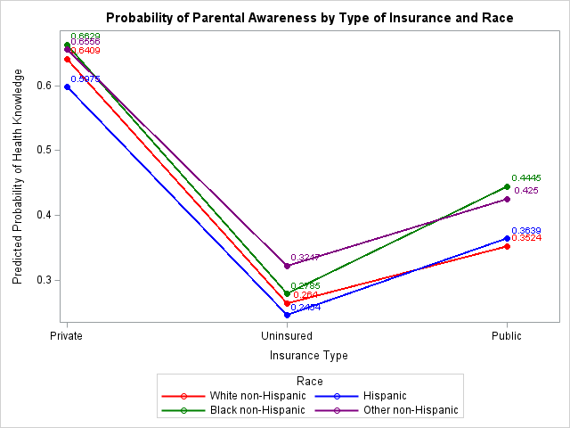
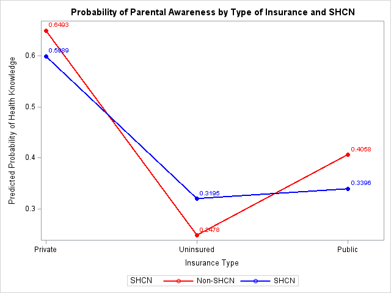

# Parental Awareness and Adolescents' Future Health Insurance

**Exploring the Impact of Current Insurance Type and Socioeconomic Factors**

MPH Capstone (Epidemiology & Biostatistics) · CUNY Graduate School of Public Health & Health Policy · December 2024
Author: Akib Rahman · Advisor: Dr. Chloe Anya Mirzayi

📄 **[Read the full paper (PDF)](paper/Rahman_Akib_CapstonePaper.pdf)** · [Word version](paper/Rahman_Akib_CapstonePaper.docx)

---

## Research question

As children age out of Medicaid and CHIP (age 19–21) or a parent's private plan (age 26), their coverage can lapse. This project asks:
**Does a child's current insurance type (private, public, or uninsured) affect whether their parents know how the child will be insured as an adult?**

## Data

- **Source:** [2022 National Survey of Children's Health (NSCH)](https://www.census.gov/programs-surveys/nsch.html), U.S. Census Bureau / HRSA Maternal and Child Health Bureau
- **Sample:** 18,423 adolescents aged 12–17 with complete exposure and outcome data
- **Outcome:** Parent's answer to *"Do you know how this child will be insured as they become an adult?"* (yes/no)
- **Exposure:** Insurance type (any public, private only, uninsured)
- **Covariates:** Age group, race/ethnicity, household Federal Poverty Level (FPL), special health care needs (SHCN)

The NSCH public-use files are free to download from the Census Bureau. They are not included in this repository.

## Methods

All analyses were run in **SAS 9.4** and account for the NSCH's complex survey design (weights, strata, clusters).

- Weighted descriptive statistics with Rao-Scott chi-square tests
- Crude and adjusted survey logistic regression (odds ratios with 95% CIs)
- Interaction models (insurance type × each covariate)
- Predicted-probability interaction plots

## Key findings

- Overall, **52.4%** of parents knew how their adolescent would be insured as an adult.
- Awareness was highest among parents of privately insured children (**63.6%**) and lowest among parents of uninsured children (**26.3%**).
- After adjustment, parents of uninsured adolescents had **77% lower odds** of awareness than parents of privately insured adolescents (aOR 0.23, 95% CI 0.16–0.34).
- Awareness rose with household income: 65.7% at ≥400% FPL vs. 39.4% at 0–99% FPL.

## Figures

Predicted probability of parental awareness by insurance type, across:

| Federal Poverty Level | Age |
|---|---|
|  |  |
| **Race/ethnicity** | **Special health care needs** |
|  |  |

## Repository contents

```
paper/      Final capstone paper (PDF and Word)
code/       SAS program that reproduces every table and figure
figures/    Interaction plots from the paper
```

## Reproducing the analysis

1. Download the **2022 NSCH Topical file (SAS format)** from the [Census Bureau NSCH datasets page](https://www.census.gov/programs-surveys/nsch/data/datasets.html). The data are not stored here: the file is over 200 MB and is freely available from the source.
2. Open [`code/capstone_analysis.sas`](code/capstone_analysis.sas) in SAS 9.4 or the free [SAS OnDemand for Academics](https://www.sas.com/en_us/software/on-demand-for-academics.html).
3. Change the `libname` path to the folder holding `nsch_2022e_topical.sas7bdat` and run the program.

The program goes through each step in the paper:

| Step | Procedure | Output |
|---|---|---|
| Sample flow and raw-value checks (incl. NSCH special missing codes) | `PROC SQL`, `PROC FREQ`, `PROC MEANS` | 54,103 → 18,762 → 18,423 |
| Recode exposure, outcome and covariates, then verify each recode | `DATA` step, `PROC FREQ` | Analytic sample, n = 18,423 |
| Weighted descriptives, Rao-Scott χ² | `PROC SURVEYFREQ` | Table 1 |
| Crude and adjusted logistic regression | `PROC SURVEYLOGISTIC` | Table 2 |
| Insurance × covariate interaction models | `PROC SURVEYLOGISTIC` | Table 3 |
| Predicted-probability interaction plots | `PROC MEANS` + `PROC SGPLOT` | Figures 1–4 |

All procedures use the NSCH design variables (`STRATA FIPSST STRATUM`, `CLUSTER HHID`, `WEIGHT FWC`).

> **About the code:** I lost the original program when my university virtual-desktop account closed. I rebuilt this script from the paper's Methods section in 2026 and checked it against the published results: the sample sizes, weighted percentages, odds ratios, confidence intervals, p-values and plotted probabilities all match the paper.

## Looking back

The paper is posted as I submitted it. Since then, I've found a few things I would do differently:

- **P-values that don't match the odds ratios in Tables 2–3.** The odds ratios and confidence intervals in the paper compare each group to its reference group. The p-values, however, came from SAS's default *effect* parameterization (`PARAM=EFFECT`), which tests each group against the average of all groups. That's why public insurance shows aOR 0.43 (95% CI 0.36–0.51) next to p = 0.343. With reference coding (`PARAM=REF`), the p-value is < .0001. So parents of publicly insured adolescents also had significantly lower odds of awareness than parents of privately insured adolescents, which changes part of the Discussion. In the script, setting `%let param = ref;` gives the corrected p-values.
- **"Crude" covariate estimates.** In Table 2, the crude estimates for age, SHCN, race and FPL come from models with insurance type plus that one covariate. They aren't truly unadjusted.
- **Typos in the tables:** 14–15 yrs crude OR should be 1.15, not 1.50. The 200–399% FPL crude CI should be 0.60–0.80. Black non-Hispanic "not aware" n should be 541. In Table 3, the strata "13-14 yrs" and "299-399%" should read 14–15 and 200–399%, and the two SHCN p-values are swapped (Public = 0.157, Uninsured = 0.163).
- **Cross-sectional design.** As noted in the paper, this design can't show whether insurance type drives awareness or the other way around.
