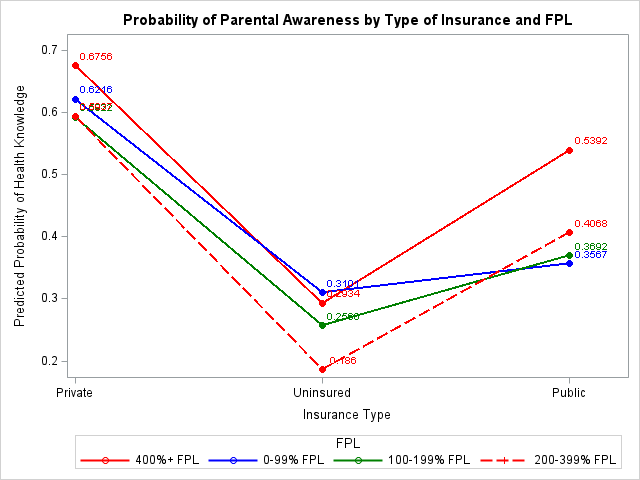

# Parental Awareness and Adolescents' Future Health Insurance

**Exploring the Impact of Current Insurance Type and Socioeconomic Factors**

MPH Capstone (Epidemiology & Biostatistics) · CUNY Graduate School of Public Health & Health Policy · December 2024
Author: Akib Rahman · Advisor: Dr. Chloe Anya Mirzayi

📄 **[Read the full paper (PDF)](paper/Rahman_Akib_CapstonePaper.pdf)** · [Word version](paper/Rahman_Akib_CapstonePaper.docx)

*Revised in 2026 to correct reporting in Tables 2–3 and the related text. The originally submitted version is in this repository's commit history.*

---

## Research question

As children age out of Medicaid and CHIP (age 19–21) or a parent's private plan (age 26), their coverage can lapse. This project asks:
**Does a child's current insurance type (private, public, or uninsured) affect whether their parents know how the child will be insured as an adult?**

## Data

- **Source:** [2022 National Survey of Children's Health (NSCH)](https://www.census.gov/programs-surveys/nsch.html), U.S. Census Bureau / HRSA Maternal and Child Health Bureau
- **Sample:** 18,423 adolescents aged 12–17 with complete exposure and outcome data
- **Outcome:** Parent's answer to *"Do you know how this child will be insured as they become an adult?"* (yes/no)
- **Exposure:** Insurance type (any public, private only, uninsured)
- **Covariates:** Age group, race/ethnicity, household Federal Poverty Level (FPL), special health care needs (SHCN)

The NSCH public-use files are free to download from the Census Bureau. They are not included in this repository.

## Methods

All analyses were run in **SAS 9.4** and account for the NSCH's complex survey design (weights, strata, clusters).

- Weighted descriptive statistics with Rao-Scott chi-square tests
- Crude and adjusted survey logistic regression (odds ratios with 95% CIs, reference-cell coding)
- Interaction models (insurance type × each covariate) with joint Wald tests
- Predicted-probability interaction plots

## Key findings

- Overall, **52.4%** of parents knew how their adolescent would be insured as an adult.
- Awareness was highest among parents of privately insured children (**63.6%**) and lowest among parents of uninsured children (**26.3%**).
- After adjustment, parents of uninsured adolescents had **77% lower odds** of awareness (aOR 0.23, 95% CI 0.16–0.34) and parents of publicly insured adolescents had **57% lower odds** (aOR 0.43, 95% CI 0.36–0.51) than parents of privately insured adolescents.
- The public–private gap **widened with age**. Awareness among parents of privately insured adolescents rose from 56% at ages 12–13 to 72% at ages 16–17, but stayed flat (35–42%) for publicly insured adolescents, right as Medicaid/CHIP eligibility nears its end.
- Awareness rose with household income: 65.7% at ≥400% FPL vs. 39.4% at 0–99% FPL.

## Figures

Predicted probability of parental awareness by insurance type, across:

| Federal Poverty Level | Age |
|---|---|
|  |  |
| **Race/ethnicity** | **Special health care needs** |
|  |  |

## Repository contents

```
paper/      Final capstone paper (PDF and Word)
code/       SAS program that reproduces every table and figure
figures/    Interaction plots from the paper
```

## Reproducing the analysis

1. Download the **2022 NSCH Topical file (SAS format)** from the [Census Bureau NSCH datasets page](https://www.census.gov/programs-surveys/nsch/data/datasets.html). The data are not stored here: the file is over 200 MB and is freely available from the source.
2. Open [`code/capstone_analysis.sas`](code/capstone_analysis.sas) in SAS 9.4 or the free [SAS OnDemand for Academics](https://www.sas.com/en_us/software/on-demand-for-academics.html).
3. Change the `libname` path to the folder holding `nsch_2022e_topical.sas7bdat` and run the program.

The program goes through each step in the paper:

| Step | Procedure | Output |
|---|---|---|
| Sample flow and raw-value checks (incl. NSCH special missing codes) | `PROC SQL`, `PROC FREQ`, `PROC MEANS` | 54,103 → 18,762 → 18,423 |
| Recode exposure, outcome and covariates, then verify each recode | `DATA` step, `PROC FREQ` | Analytic sample, n = 18,423 |
| Weighted descriptives, Rao-Scott χ² | `PROC SURVEYFREQ` | Table 1 |
| Crude and adjusted logistic regression | `PROC SURVEYLOGISTIC` | Table 2 |
| Insurance × covariate interaction models | `PROC SURVEYLOGISTIC` | Table 3 |
| Predicted-probability interaction plots | `PROC MEANS` + `PROC SGPLOT` | Figures 1–4 |

All procedures use the NSCH design variables (`STRATA FIPSST STRATUM`, `CLUSTER HHID`, `WEIGHT FWC`).

> **About the code:** I lost the original program when my university virtual-desktop account closed. I rebuilt this script from the paper's Methods section in 2026. Its output matches every table and figure in the paper.

## Looking back

If I were starting this project today, I would approach a few things differently:

- **Report effects on a probability scale.** About half of parents were aware, so odds ratios overstate relative differences (an OR of 0.23 is not "77% less likely"). I'd lead with predicted probabilities or prevalence ratios. For example, 26% of parents of uninsured adolescents were aware, compared with 64% of parents of privately insured adolescents. Those numbers are easier for policymakers to act on.
- **Use subpopulation (DOMAIN) analysis.** Instead of subsetting the file to adolescents with complete data, I'd keep the full sample in the survey procedures and define the analytic group as a domain. That's the recommended way to keep variance estimates design-correct.
- **Keep "public only" and "public + private" separate.** Combining them into "any public" simplified the comparison but may hide differences among families who hold both kinds of coverage.
- **Account for state policy.** Medicaid and CHIP age limits and transition rules differ by state. Adding state-level variables (e.g., Medicaid expansion status), or using models that account for state, would connect the results more directly to policy.
- **Add measures of parent knowledge and resources.** Parent education, health literacy, and whether the adolescent has a medical home with transition planning (all in the NSCH) could help explain *why* awareness differs.
- **Write a pre-specified analysis plan and use version control from day one.** Writing out each model before running it, and keeping the code in a Git repository, makes every number easy to trace. It also would have saved my original code.
- **Longitudinal data.** A cross-sectional survey can't show whether insurance type shapes awareness or whether more informed parents choose private coverage. Following families through the transition to adulthood would answer that.
